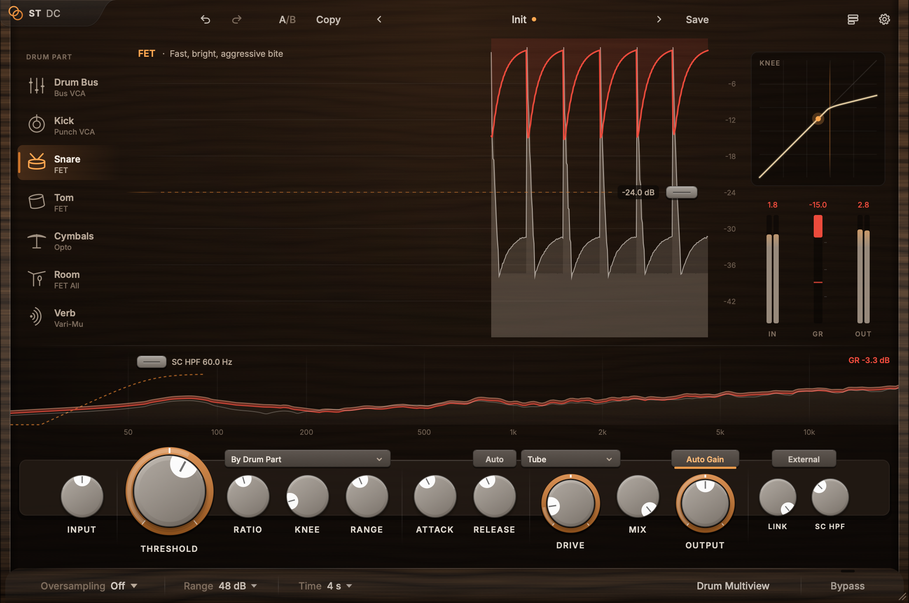
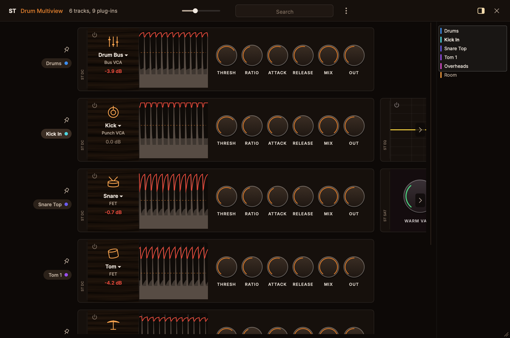

# ST DC

A drum compressor for every part of the kit. Tell it which part of the kit the track is — **Drum Bus, Kick, Snare,
Tom, Cymbals, Room or Verb** — and it runs the compression engine built for that part, with a starting point dialled
in. It is part of the ST family (built on [st-shell](https://github.com/davidstokarski/st-shell)): dark walnut,
Pro-style level display, and a **Drum Multiview** that shows every drum track in the session with the other ST
plug-ins on those tracks.



**Download (macOS, Apple Silicon + Intel):**
[ST-DC-macOS.zip](https://github.com/davidstokarski/st-dc/releases/latest/download/ST-DC-macOS.zip) —
copy `ST DC.vst3` to `~/Library/Audio/Plug-Ins/VST3/` and `ST DC.component` to `~/Library/Audio/Plug-Ins/Components/`.
The builds are ad-hoc signed; if macOS blocks them run
`xattr -dr com.apple.quarantine ~/Library/Audio/Plug-Ins/VST3/"ST DC.vst3" ~/Library/Audio/Plug-Ins/Components/"ST DC.component"`.

## Which engine for which drum

| Part | Engine | Why |
|---|---|---|
| Drum Bus | **Bus VCA** — feed-forward VCA, blended peak/RMS detector, auto release | The classic bus "glue" compressor is a clean, neutral VCA design: low ratio (2–4:1), slow attack (10–30 ms) so the hits come through, programme-dependent release so it doesn't pump. Side-chain high-pass on (90 Hz) so the kick doesn't drive it. |
| Kick | **Punch VCA** — true-RMS detector, programme-dependent attack, constant-rate (dB/s) release | RMS sensing holds the low end steady without the distortion a fast FET adds to the sub; the attack lets the beater click through and the linear release gives the punchy recovery of the classic RMS VCA units used on kicks. |
| Snare | **FET** — feedback FET, attack down to 20 µs, harmonics that grow with gain reduction | FETs are the fastest classic design and are the usual pick for kick and snare "snap" and crack: they grab the stick hit and add bite. |
| Tom | **FET** (slower starting point) | Same FET, but with a slower attack so the stick stays and a medium release that brings the ring and sustain up. |
| Cymbals | **Opto** — optical feedback cell: soft wide knee, ratio that rises with level, two-stage release with memory | Optical compressors are the slow, smooth, programme-dependent option (~10 ms average attack); they level overheads gently without grabbing transients, so the wash doesn't swirl or pump. Side-chain high-pass at 160 Hz keeps the kick from triggering it. |
| Room | **FET All** — FET with every ratio engaged: over-compressing curve, faster release, much more distortion | "All buttons in" with the fastest attack and release is the standard room-mic crush: aggressive, distorted, pumping, bringing up the room and shell resonance. Starts at 70% mix so some of the room's own sound stays. |
| Verb | **Vari-Mu** — tube feedback compressor whose ratio rises gradually with gain reduction, with even harmonics | I didn't find a clear published convention for compressing reverb returns, so this one is a judgment call: a very soft-kneed, slow, tube-coloured compressor makes the tail denser and more even without clamping it. For ducking the verb under the dry kit, use the **Verb Ducker (Side-Chain)** preset and feed the dry drums into the side-chain. |

You can run any engine on any part (the **Engine** menu above the threshold): the part's row then shows the override
in amber.

Sources used for the choices above: Vintage King, ["The best compressors for mixing drums"](https://vintageking.com/blog/the-best-compressors-for-mixing-drums/);
Sweetwater, ["All-button mode: Universal Audio 1176"](https://www.sweetwater.com/insync/all-button-mode-universal-audio-1176-really-explosive-drum/);
Universal Audio, [1176 tips & tricks](https://www.uaudio.com/blogs/ua/1176-collection-tips) and
[LA-2A tips & tricks](https://www.uaudio.com/blogs/ua/la-2a-collection-tips-tricks);
Wikipedia, [LA-2A Leveling Amplifier](https://en.wikipedia.org/wiki/LA-2A_Leveling_Amplifier);
Sound On Sound, [Drum compression](https://www.soundonsound.com/techniques/drum-compression);
FabFilter, [Pro-C style and character](https://www.fabfilter.com/help/pro-c/using/styleandcharacter) (interaction model).
Hardware names are mentioned only to explain the research; the plug-in uses its own engine names.

## Controls

- **Drum Part** (left): picks the engine and loads that part's starting point (one undo step; right-click a part to
  switch the engine but keep your settings). Automating the Drum Part parameter only switches the engine.
- **Input, Threshold, Ratio, Knee, Range** — the threshold is also a handle on the level display.
- **Attack, Release** with **Auto** release (programme-dependent: short hits recover fast, sustained compression slowly).
- **Drive** with **Character** (Tube / Tape / Transformer): saturation after the compressor, on top of the colour
  each engine brings by itself.
- **Mix** (parallel compression, latency aligned), **Output** with **Auto Gain**.
- **Link** (stereo link), **SC HPF** (side-chain high-pass, also a handle on the spectrum), **External** side-chain
  input.
- Footer: **Oversampling** (Off / 2x / 4x for the colour stage), level display **Range** and **Time**,
  **Drum Multiview**, **Bypass**.

## Display

- **Level history** (Pro-style): input as a dark fill, output as a light fill with a line, gain reduction as a red
  trace hanging from the top, newest at the right; dashed threshold with a draggable handle.
- **Knee**: the running engine's transfer curve with the live detector level riding it.
- **Meters**: In / GR / Out with peak hold.
- **Spectrum** (FFT) of the input with the compression on top of it: the red band is what the compressor is taking
  away right now. The side-chain high-pass is a dashed curve with a handle, and the region the detector doesn't hear
  is shaded.

## Drum Multiview



Click the multiview icon in the header (or **Drum Multiview** in the footer). It shows **only tracks that have an ST
DC on them**, sorted in kit order (bus, kick, snare, toms, cymbals, room, verb), with ST DC leftmost so the
compressors line up in one column — and **every other ST plug-in on those tracks** (ST EQ, ST Sat...) next to it,
fully editable. Each ST DC module shows the part (click it to change), engine, live gain reduction, a level/GR
history with the threshold, a bypass switch and Threshold / Ratio / Attack / Release / Mix / Out.

## Build & test

```bash
cmake -S . -B build -G Ninja -DCMAKE_BUILD_TYPE=Release -DSTDC_BUILD_TESTS=ON && cmake --build build
./build/tests/StDcPluginTests_artefacts/Release/StDcPluginTests              # engine curves, timing, nulls, stress, state, multiview
./build/tests/StDcPluginTests_artefacts/Release/StDcPluginTests --snapshot /tmp/stdc   # PNGs of the editor and multiview
auval -v aufx Stdc StAu
```

Uses `../st-shell` when it is checked out next to this repo, otherwise fetches it. Release: `scripts/release.sh`.

Inter typeface © The Inter Project Authors, SIL Open Font License.
